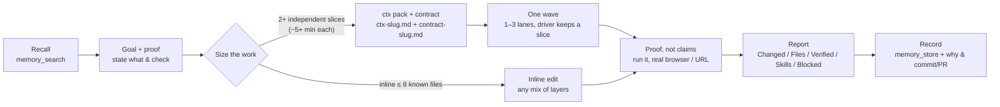

<div align="center">

<picture>
  <source media="(prefers-color-scheme: dark)" srcset="https://raw.githubusercontent.com/chadixearth/graphyloop/main/assets/logo-dark.svg">
  
</picture>

[](https://github.com/chadixearth/graphyloop)
[](https://www.npmjs.com/package/graphyloop)
[](https://www.npmjs.com/package/graphyloop)
[](integrations/claude-code/)
[](https://registry.modelcontextprotocol.io/v0.1/servers?search=io.github.chadixearth/graphyloop)
[](https://github.com/chadixearth/graphyloop/actions/workflows/ci.yml)
[](LICENSE)

# GraphyLoop

</div>

GraphyLoop is a one-command agentic workflow kit for AI coding agents: it wires Claude Code, OpenCode, Codex, Cursor, Gemini CLI, Oh My Pi and DeepSeek Harness with Workflow v3 (inline-first, one parallel wave, proof before done), a 25-agent squad, persistent memory, Agent Skills and an MCP server. It also ships as a Claude Code plugin and an MCP Registry server. Zero dependencies.

[Landing page](https://chadixearth.github.io/graphyloop/) · [npm](https://www.npmjs.com/package/graphyloop) · [Harness guide](docs/harnesses.md) · [Reference](docs/reference.md) · [llms.txt](llms.txt)

## Quick Start

Pick one of three install channels:

### 1. `npx` installer (all 7 harnesses)

```bash
npx graphyloop        # a bare command installs — it wires every harness it detects
# restart your harness, open a real project, then ask your agent:
/chadi-init
```

Requires Node.js ≥ 20. On a fresh machine with no harness yet, GraphyLoop wires all seven so you are ready whichever one you open first. Target specific ones with `--harness claude,omp`. Nothing is written into your workspace — everything lives in your home config (`~/.graphyloop/` plus each harness's own directory).

### 2. Claude Code plugin marketplace

Inside Claude Code:

```text
/plugin marketplace add chadixearth/graphyloop
/plugin install graphyloop@graphyloop
# then start the workflow with:
/graphyloop:chadi-init
```

The marketplace manifest is [`.claude-plugin/marketplace.json`](.claude-plugin/marketplace.json) and the plugin lives at [`integrations/claude-code/`](integrations/claude-code/) (15 `/graphyloop:chadi-*` commands, 26 agents, 3 core skills, and the `graphyloop` MCP server). **Use the plugin OR `npx graphyloop --harness claude` for Claude Code, not both** (installing both registers duplicate tools and agents).

### 3. MCP Registry

Server name: **`io.github.chadixearth/graphyloop`** ([`server.json`](server.json)). Any MCP client that resolves from the official MCP Registry runs the `graphyloop` npm package over stdio via:

```bash
npx -y graphyloop mcp
```

### Supported harnesses

| Harness | `--harness` | Detected when | How GraphyLoop wires it | Start the workflow |
|---|---|---|---|---|
| **OpenCode** | `opencode` | `~/.config/opencode/` | plugin (`graphyloop_*` tools) + 26 agents + 15 `/chadi-*` commands + AGENTS.md | `/chadi-init` |
| **Claude Code** | `claude` | `~/.claude/` or `~/.claude.json` | MCP server + 26 agents + 15 commands + `~/.claude/rules/graphyloop-workflow.md` (or install the [Claude Code plugin](integrations/claude-code/) instead) | `/chadi-init` (plugin: `/graphyloop:chadi-init`) |
| **Codex** | `codex` | `~/.codex/` | MCP server + 15 prompts + bundled skills in `~/.agents/skills/` + AGENTS.md | `/prompts:chadi-init` |
| **Cursor / Windsurf** | `cursor` | `~/.cursor/` | MCP server + bundled skills in `~/.agents/skills/` (workflow loads from `graphyloop-workflow` skill; project init writes `<project>/AGENTS.md`) | ask: "run the graphyloop workflow init" |
| **DeepSeek Harness** | `dsh` | `~/.dsh/` or `$DSH_HOME` | MCP server + 26 role prompts + `graphyloop-squad` skill + AGENTS.md | load the `graphyloop-squad` skill |
| **Oh My Pi** | `omp` | `~/.omp/` | MCP server in `~/.omp/agent/mcp.json` + 26 squad agents + skills; AGENTS.md only if you have none | ask: "run the graphyloop workflow init" |
| **Gemini CLI** | `gemini` | `~/.gemini/` | MCP server in `~/.gemini/settings.json` + `/chadi-*` TOML commands + bundled skills in `~/.gemini/skills/`; GEMINI.md only if you have none | `/chadi-init` |

Per-harness file locations, verification, dsh notes, and the Gemini CLI sign-in change (personal Google sign-ins stopped working on June 18, 2026; an API key still works): [docs/harnesses.md](docs/harnesses.md).

### Setup with any AI assistant (copy-paste)

Paste the block below into your AI harness — it installs, verifies (`GRAPH_LOOP_DOCTOR_OK`), and reports on its own. Raw copy: [`docs/SETUP-PROMPT.md`](docs/SETUP-PROMPT.md).

```
You are setting up GraphyLoop (github.com/chadixearth/graphyloop, npm package `graphyloop`) — a one-command agentic workflow kit for AI coding agents: a 25-agent squad, parallel wave planning, persistent memory, a harness-neutral workflow and an MCP server that works in any harness. Zero dependencies.

Goal: install it for THIS machine's harness(es), verify the install actually works, and report. Do NOT edit any config file by hand — run only the installer. Do NOT run npm publish, npm login, or anything unrelated.

Steps:
1. Prerequisites:
   - Run `node --version` — must be 20 or newer. If older, tell the user to install Node.js 20+ and stop there.
   - Detect which harnesses exist on this machine (check for any of): ~/.config/opencode/  (OpenCode), ~/.claude.json or ~/.claude/  (Claude Code), ~/.codex/  (Codex), ~/.cursor/  (Cursor / Windsurf), ~/.dsh/ or $DSH_HOME  (DeepSeek Harness / `dsh`), ~/.omp/  (Oh My Pi / `omp`), ~/.gemini/  (Gemini CLI). On Windows, ~ = %USERPROFILE%.
2. Install:
   - Run:  npx --yes graphyloop
     (a bare `graphyloop` is the install command: it wires every detected harness, or all 7 on a fresh machine.)
   - To target specific harnesses:  npx --yes graphyloop --harness claude,omp   (names: opencode, claude, codex, cursor, dsh, omp, gemini)
   - Optional Claude Code plugin path (use the plugin OR `npx graphyloop --harness claude`, not both): inside Claude Code run `/plugin marketplace add chadixearth/graphyloop` then `/plugin install graphyloop@graphyloop`.
   - If npx asks "Ok to proceed?", answer yes. If npx is missing, stop and tell the user to install Node.js 20+ (npx ships with npm).
3. Verify — every applicable check must pass:
   - `npx --yes graphyloop doctor` prints one row per harness (present / wired) and its LAST line must be GRAPH_LOOP_DOCTOR_OK. If it prints GRAPH_LOOP_DOCTOR_ISSUES <n>, run the `fix:` command it shows for each unwired row, then run doctor again.
   - Core engine files exist: ~/.graphyloop/graphyloop/cli.mjs , ~/.graphyloop/mcp-server.mjs , ~/.graphyloop/lib/mcp.mjs , ~/.graphyloop/lib/engine.mjs .
   - OpenCode (if present): ~/.config/opencode/opencode.json contains plugin entries "./plugins/graphyloop/plugin.js" and "./plugins/server-guard/plugin.js", and ~/.config/opencode/agents/ contains 26 .md files.
   - Claude Code (if present): ~/.claude.json has an mcpServers.graphyloop entry, ~/.claude/rules/graphyloop-workflow.md exists, and ~/.claude/agents/ is populated (unless using the Claude Code plugin instead).
   - Codex (if present): ~/.codex/config.toml contains a [mcp_servers.graphyloop] section, and ~/.agents/skills/graphyloop-workflow/SKILL.md exists.
   - Cursor (if present): ~/.cursor/mcp.json has a "graphyloop" entry, and ~/.agents/skills/graphyloop-workflow/SKILL.md exists (Cursor uses no home rules file; the workflow loads from ~/.agents/skills/graphyloop-workflow).
   - DeepSeek Harness (if present): ~/.dsh/cordis.patch.yml contains a row `id: graphyloop-mcp` naming '@deepseek-ai/dsh-mcp-client', ~/.dsh/AGENTS.md exists, and ~/.dsh/skills/ holds graphyloop-squad. Optional deeper check: `dsh --profile headless --dump-config` prints that row. In dsh the tools are namespaced — call them as mcp__graphyloop__<name> (e.g. mcp__graphyloop__swarm_state).
   - Oh My Pi (if present): ~/.omp/agent/mcp.json has mcpServers.graphyloop, and ~/.omp/agent/agents/ holds the squad .md files. An existing ~/.omp/agent/AGENTS.md is intentionally kept — the workflow then loads from the bundled skill graphyloop-workflow.
   - Gemini CLI (if present): ~/.gemini/settings.json has mcpServers.graphyloop, ~/.gemini/commands/chadi-init.toml exists, and graphyloop-workflow/SKILL.md exists in ~/.gemini/skills/ (or ~/.agents/skills/ when Codex/Cursor is also installed). An existing ~/.gemini/GEMINI.md is intentionally kept.
   - If any check fails: re-run the install with --force (automatic backups) and re-verify. Still failing? Report the exact error and stop.
4. Wrap up: tell the user to RESTART their harness (close/reopen the terminal or editor), open a real project (not their home directory), and start the workflow: ask for /chadi-init (OpenCode, Claude Code, Gemini CLI — or /graphyloop:chadi-init with the Claude Code plugin), /prompts:chadi-init (Codex), or "run the graphyloop workflow init" (Oh My Pi, Cursor, Windsurf). In the DeepSeek Harness there are no slash commands: ask the agent to load the `graphyloop-squad` skill instead. Give a one-line summary of what was installed.

Do not ask permission for reversible steps — proceed. Stop only for: Node < 20, an install failure, or a prompt you cannot answer.
```

## How the workflow works

**Workflow v3** is harness-neutral: the same 12 rules run in OpenCode, Claude Code, Codex, Cursor, Windsurf, DeepSeek Harness, Oh My Pi and Gemini CLI.



1. **Recall first, record last** — `memory_search` before planning; `memory_store` one dense line after, including the *why* and the commit/PR it landed in.
2. **Goal + proof up front** — state the end state, the measurable check that proves it, and the invariant it must not break ("prompt the what, not the how"; never weaken a test to make it pass).
3. **Inline first (measured)** — up to 8 known files in any mix of layers, when the code is known or mappable in one batched read pass; a dispatch costs the driver minutes of waiting while an inline edit costs seconds.
4. **Fan out only for 2+ independent slices of about 5+ minutes each** — 1–3 lanes (max 4), strictly disjoint files; the driver keeps the largest or most coupled slice and builds it while lanes run.
5. **Context pack before dispatch** — write `ctx-<slug>.md` (`path:line`, current code, pattern to copy) so lanes start editing instead of rediscovering.
6. **Freeze the contract** — `contract-<slug>.md` is the only cross-lane dependency.
7. **Turn economy** — batch reads, first edit by turn 5, done in about 20 turns (40+ = mis-sized).
8. **Isolate what collides** — a lane that runs servers, databases or browsers gets its own worktree, port and database name.
9. **No polling; schedule follow-ups** — background jobs or the tool's blocking command; post-deploy checks via the harness's scheduler/loop (e.g. Claude Code `/loop` or `/schedule`), never a sleep loop.
10. **Proof, not claims** — failing-before/passing-after test, real-browser screenshot for UI, before/after numbers from the same machine for performance, the live URL answering for deploys (not "tests pass" alone, typecheck alone, "should work", or a mocked run).
11. **Review by blast radius** — reviewer/security lanes only for migrations, auth/RBAC, payments, secrets, tenant boundaries, public API contracts and the project's named central files; everything else is covered by proof.
12. **Evidence-first report** — Changed / Files / Verified (command + verbatim output) / Skills / Blocked.

**Keep the rules honest:** always-loaded rules stay short while detailed procedures live in skills loaded on demand (progressive disclosure); test workflow guidance with control-vs-treatment runs and delete rules that show no effect; don't hand-manage tokens (compaction works), but persist anything needed after compaction into files (`ctx-<slug>.md`, `contract-<slug>.md`, memory). For posters, decks, PDFs and video, the **Artifact wave** pattern freezes `brief-<slug>.md`, builds the hero piece first, and fans out one lane per artifact.

The `plan_feature` MCP tool reports `inlineThreshold: 8`, writes the contract and context pack, returns the wave plan, and ends every builder lane brief with the turn-economy footer.

## Features

| Capability | Description |
|---|---|
| 🐝 **Swarm orchestration** | Spawn, distribute, and track agents with a hierarchical swarm topology — zero API keys, state in `<project>/.graphyloop/state.json` |
| 🧠 **Persistent memory** | Store decisions, patterns, lessons, and events; keyword-search across sessions. Survives restarts and compactions |
| 🤖 **25-agent squad** | Specialized agents for exploration, backend, frontend, testing, security, review, refactoring, docs, data, performance, and more (26 agent files including the driver; see [The squad](#the-squad-25-agents)) |
| 🌊 **Wave planner** | One call turns "I want an inventory system" into context pack + contract → **database ∥ backend ∥ frontend ∥ tests** → integration → **test ∥ typecheck ∥ security ∥ performance ∥ review** → gated deploy, with file ownership and dependencies the engine enforces |
| 🔌 **Universal MCP bridge** | The same 15 graphyloop tools work in all 7 harnesses — any MCP-capable harness |
| 🧩 **Claude Code plugin** | Install from the marketplace with `/plugin marketplace add chadixearth/graphyloop` and `/plugin install graphyloop@graphyloop` ([`integrations/claude-code/`](integrations/claude-code/), [`.claude-plugin/marketplace.json`](.claude-plugin/marketplace.json)) — 15 `/graphyloop:chadi-*` commands, 26 agents, 3 core skills and MCP server |
| 🗂️ **MCP Registry** | Registered as `io.github.chadixearth/graphyloop` ([`server.json`](server.json)), published with GitHub OIDC, runs `npx -y graphyloop mcp` over stdio |
| 📋 **15 slash commands** | `chadi-init` · `chadi-fast` · `chadi-review` · `chadi-plan` · `chadi-waves` · `chadi-db` · `chadi-deploy` · `chadi-audit` · `chadi-release` · `chadi-research` · `chadi-confusing` · `chadi-discuss` · `chadi-go` · `chadi-recall` · `chadi-skills` |
| 🔑 **Supabase + Vercel credentials** | Store keys once per project (chmod 600, git-ignored before the first write), sync them into the env file the framework reads, and preflight database/deploy work. Values are never returned to the model |
| 📚 **70 bundled skills (Agent Skills)** | Contract-first waves, API hardening, frontend security, accessibility, web performance, dependency audit, Supabase, Vercel, secrets, memory, the workflow itself, plus design, research, GSAP and three.js packs. Installed into `~/.agents/skills` for Codex and Cursor (the cross-tool Agent Skills directory, also read by GitHub Copilot/VS Code and Gemini CLI). A skill you already have is never overwritten ([details](docs/reference.md#configuration)) |
| 🔒 **Config safety** | Timestamped backups before every write, never overwrites your config keys, idempotent re-runs, uninstall removes only byte-identical copies |
| 🪟 **Windows hang guard** | `npm run dev` inside an agent session no longer freezes the turn: server-guard starts the server without inheriting the tool's stdout pipe, so the call returns in milliseconds while the server keeps serving |
| ⚡ **Zero dependencies** | Pure Node (≥ 20), no npm packages at runtime, no shell scripts — installs the same on every platform. MIT licensed |

### Harness alone vs + GraphyLoop

| Capability | Harness alone | + GraphyLoop |
|---|---|---|
| Agent collaboration | Isolated sessions | Swarm with shared memory |
| Orchestration | Manual | Workflow v3: inline ≤ 8 files, context pack, frozen contract, one parallel wave, 25-agent squad |
| Memory | Session-only | Persistent, searchable, survives restarts |
| Multi-harness | One tool, one rules file | Same workflow in 7 harnesses |
| Delivery discipline | Ad hoc | Proof-not-claims and evidence-first reports |
| Setup | Hand-written rules per tool | `npx graphyloop`, Claude Code plugin, or MCP Registry |
| Safety | — | Backup-first config merges, content-matched uninstall |

## FAQ

### What is GraphyLoop?
GraphyLoop is a one-command agentic workflow kit for AI coding agents. It installs a 25-agent squad, parallel wave planning, persistent memory and an MCP server into the harnesses you already use. It is open source (MIT) with zero runtime dependencies.

### What changed in Workflow v3?
Workflow v3 (12 rules) raises the measured inline threshold to up to 8 known files (`inlineThreshold: 8` in `plan_feature`), fans out only when there are 2+ independent slices of about 5+ minutes each while the driver keeps the largest or most coupled slice, tightens turn economy to ~20 turns (first edit by turn 5), adds explicit rules for goal + proof up front, isolating colliding resources (worktree, port, DB), scheduling follow-ups instead of polling, proof over claims, and review by blast radius, and adds a "Keep the rules honest" section on progressive disclosure, control-vs-treatment rule testing, and compaction-safe file persistence.

### Can I install GraphyLoop as a Claude Code plugin?
Yes. In Claude Code run `/plugin marketplace add chadixearth/graphyloop` and then `/plugin install graphyloop@graphyloop`. The plugin ([`integrations/claude-code/`](integrations/claude-code/)) installs 15 `/graphyloop:chadi-*` commands, 26 agents, 3 core skills (`graphyloop-workflow`, `graphyloop-waves`, `swarm-memory`) and the `graphyloop` MCP server. Use the plugin OR `npx graphyloop --harness claude`, not both, to avoid duplicate tools and agents.

### Is GraphyLoop in the MCP Registry?
Yes. It is registered as `io.github.chadixearth/graphyloop` (defined in [`server.json`](server.json)) and runs the npm package `graphyloop` over stdio via `npx -y graphyloop mcp`. Any MCP client that resolves servers from the MCP Registry can install it by that name.

### Does GraphyLoop follow the Agent Skills standard?
Yes. Every bundled skill is a directory with a `SKILL.md` manifest, and `--harness codex` and `--harness cursor` install all 70 bundled skills into `~/.agents/skills` — the cross-tool user skills directory read by Codex and Cursor (and also recognized by GitHub Copilot / VS Code and as an alias by Gemini CLI). Untouched shipped skills are refreshed on update, your edited skills are kept, and uninstall removes untouched skills from `~/.agents/skills` only when no other GraphyLoop harness using that directory (`codex`, `cursor`) stays installed.

### Does GraphyLoop work with Claude Code, Cursor and Gemini CLI?
Yes. For Claude Code it registers an MCP server in `~/.claude.json`, installs 26 agent files, 15 `/chadi-*` slash commands, skills and the workflow rule at `~/.claude/rules/graphyloop-workflow.md` (or install via the Claude Code plugin instead — use one or the other, not both). For Cursor and Windsurf it adds the MCP server to `~/.cursor/mcp.json` and installs the 70 bundled skills into `~/.agents/skills/` — Cursor ignores plain `.md` files in `.cursor/rules/` and keeps global User Rules in its settings UI, so no rules file is written; the workflow loads from the `graphyloop-workflow` skill in `~/.agents/skills/` (and running workflow init in a project writes `<project>/AGENTS.md`). For Gemini CLI it adds the MCP server to `~/.gemini/settings.json`, installs the commands as TOML files in `~/.gemini/commands/`, and installs the bundled skills in `~/.gemini/skills/` (or reuses `~/.agents/skills/` when Codex/Cursor is present) without overwriting an existing `GEMINI.md`. Note: since June 18, 2026 Google no longer serves personal Google sign-ins in Gemini CLI ("This client is no longer supported for Gemini Code Assist for individuals"); it still works with a Gemini API key, Vertex AI, or a Code Assist Standard/Enterprise license, while Google's successor for individuals — Antigravity CLI (`agy`) — is not supported yet.

### Which other harnesses are supported?
Seven in total: OpenCode, Claude Code, Codex, Cursor, DeepSeek Harness (`dsh`), Oh My Pi (`omp`) and Gemini CLI. For Codex, GraphyLoop wires `[mcp_servers.graphyloop]` in `~/.codex/config.toml`, 15 `/prompts:chadi-*` prompts, `AGENTS.md`, and the 70 bundled skills in `~/.agents/skills/`. Anything else that speaks MCP can use the same server via `npx graphyloop mcp` or `io.github.chadixearth/graphyloop` from the MCP Registry. See [docs/harnesses.md](docs/harnesses.md) for what is written where.

### Is GraphyLoop free?
Yes. It is MIT licensed and free to use, fork and modify. It uses the model your harness already has; GraphyLoop itself adds no subscription or usage fee.

### Does GraphyLoop need API keys?
No. The swarm, memory and MCP tools run locally with no API keys. The only optional key is `DEEPSEEK_API_KEY`, for letting the engine call DeepSeek directly, and nothing requires it.

### How is it different from a plain AGENTS.md or CLAUDE.md?
A rules file is static text that one tool reads. GraphyLoop adds a live engine behind an MCP server (persistent memory, a wave planner that writes the contract and context pack, task and file-ownership tracking) and a 25-agent squad, and installs the same workflow into seven harnesses instead of one.

### How do I uninstall GraphyLoop?
Run `npx graphyloop uninstall`. It removes the core in `~/.graphyloop/`, the MCP entries it added, and agents, commands, skills and rules files that are still byte-identical to what it shipped (for `~/.agents/skills/`, untouched copies are removed only when neither `codex` nor `cursor` stays installed). Anything you edited, and all backups, stay.

### Does GraphyLoop send my data anywhere, and does it work on Windows?
It sends nothing anywhere: state and memory are plain files in `<project>/.graphyloop/`, the MCP server runs locally over stdio, and stored credentials are chmod 600 and never returned to the model. It works on Windows, macOS and Linux; CI runs all three on Node 20, 22 and 24, and on Windows a server-guard keeps `npm run dev` from hanging an agent session.

---

## MCP tools

Once installed, any MCP-capable harness can call:

| Tool | Purpose |
|---|---|
| `agent_spawn` | Spawn a swarm agent — `coder`, `tester`, `reviewer`, `architect`, `explorer`, `security`, `coordinator`, `frontend`, `data` |
| `agent_list` | List swarm agents |
| `plan_feature` | Turn a feature request into a **wave plan** — contract → parallel builders → integration → parallel verifiers → gated deploy, with per-lane file ownership, acceptance checks and `dependsOn` |
| `task_distribute` | Distribute tasks across the swarm. Honours `wave` + `dependsOn`, and answers with `dispatchNow` (safe to fan out) vs `blocked` (with `waitingOn`) |
| `task_record` | Record a task result (updates agent metrics, reports what the result unblocked) |
| `swarm_state` | Swarm status + memory count + ready/blocked tasks per wave |
| `memory_store` | Persist a memory entry — `decision`, `pattern`, `lesson`, `event`, `task` |
| `memory_search` | Keyword-search stored memories — ranked by match quality with a recency bias, optional `type` filter |
| `memory_forget` | Delete one memory by id, so a wrong lesson can be corrected instead of recalled forever |
| `secrets_status` | Masked readiness report for Supabase/Vercel credentials — which keys exist, where each comes from, what is missing. **Never returns a value** |
| `secrets_set` | Store one credential in `<project>/.graphyloop/secrets.json` (chmod 600, git-ignored before the first write) |
| `env_sync` | Write stored credentials into the env file the framework reads, add public aliases for public keys only, refresh a values-free `.env.example`, guard `.gitignore` |
| `preflight` | Readiness check + ordered command plan for `db` / `deploy` — blockers, warnings, and gates on every destructive step. Executes nothing |
| `skills_status` | Which skills are actually installed (project, OpenCode, Claude, `~/.agents/skills`, Oh My Pi, Gemini and dsh roots), which bundled ones are present, which referenced ones are missing — so an agent states a gap instead of faking a skill |
| `shutdown` | Gracefully stop the swarm |

State and performance details: [docs/reference.md](docs/reference.md#mcp-server-internals). Verify the connection any time:

```bash
npx graphyloop doctor   # ends with GRAPH_LOOP_DOCTOR_OK when every present harness is wired
claude mcp list         # look for: graphyloop ... √ Connected
codex mcp list          # look for: graphyloop ... enabled
```

## The squad (25 agents)

| Role | Agents |
|---|---|
| **Conductor** | `agent-chadi` — the primary agent running the 5-gate workflow |
| **Exploration** | `chadi-explorer` · `graphcrew-investigator` |
| **Implementation** | `chadi-backend` · `chadi-frontend` · `chadi-integrator` · `graphcrew-builder` · `graphcrew-fixer` · `chadi-refactor` |
| **Verification** | `chadi-test` · `chadi-quality` · `chadi-reviewer` · `graphcrew-reviewer` |
| **Security** | `chadi-security` |
| **Architecture & Planning** | `chadi-architect` · `chadi-think` · `chadi-council` |
| **Data & DevOps** | `chadi-data` · `chadi-devops` |
| **Docs & Media** | `chadi-docs` · `chadi-vision` · `story-video-automator` |
| **Memory & Meta** | `chadi-memory` · `chadi-agent-writer` · `chadi-performance` |

---

## CLI reference

```
npx graphyloop                      # same as: install — wires every detected harness
npx graphyloop install [--harness opencode|claude|codex|cursor|dsh|omp|gemini|all]   # comma list ok: --harness claude,omp
                       [--force] [--skip-agents] [--skip-workflow]
                       [--no-config-merge] [--config-dir DIR] [--graphyloop-dir DIR]
npx graphyloop update [--check]     # refresh an existing install in place
npx graphyloop doctor               # per harness: present / wired / fix: — ends GRAPH_LOOP_DOCTOR_OK
npx graphyloop status [--json]      # swarm status via the graphyloop engine
npx graphyloop uninstall            # remove only what graphyloop added
npx graphyloop mcp                  # run the MCP server directly (stdio)
```

| Flag | Meaning |
|---|---|
| `--harness` | `opencode` / `claude` / `codex` / `cursor` / `dsh` / `omp` / `gemini` / `all`, or a comma list — default: every detected harness (all seven on a fresh machine) |
| `--home DIR` | Install into a different home directory (testing, containers). Also wins over `$DSH_HOME`, so a sandboxed run cannot reach a real harness home |
| `--force` | Overwrite existing graphyloop files (previous copies backed up as `*.bak-<timestamp>`) |
| `--check` | `update` only: report version/file drift and exit without writing. `install` has no dry-run — `install --check` / `--dry-run` exit 1; preview with `graphyloop doctor` |
| `--skip-agents` / `--skip-workflow` | Skip agents/prompts or the rules file |
| `--no-config-merge` | Never touch `opencode.json`, `.claude.json`, `config.toml`, `mcp.json`, `settings.json`, `cordis.patch.yml` |

With no command, bare install flags (`--home`, `--harness`, `--force`, …) still install, but any other flag (`--check`, `--dry-run`, `--json`, a typo like `--doctor`) exits 1 with `unknown option … (no command given)` and writes nothing; name the command (`graphyloop doctor`, `graphyloop update --check`). Next to an explicit command, unknown flags are ignored.

**Safety guarantees** (all covered by tests):

- Never overwrites your existing config keys — plugin lists, commands, MCP servers, `default_agent`, models preserved exactly.
- Every write is preceded by a timestamped backup.
- Re-running is always safe (idempotent).
- Uninstall removes **only** files byte-identical to the shipped copies — anything you edited is left alone.
- An existing Oh My Pi `AGENTS.md` or Gemini CLI `GEMINI.md` is kept, even with `--force`; the workflow then loads from the bundled `graphyloop-workflow` skill.

## Updates

```bash
npx -y graphyloop@latest update           # refresh the install in place
npx graphyloop update --check             # report the drift, write nothing
npx graphyloop doctor                     # installed core version vs this package
```

`update` refreshes graphyloop only in the tools it is already installed in. A tool you never added it to stays untouched, and `--harness <name>` adds one. It overwrites graphyloop-owned files (timestamped backup first), repairs a core tree that is missing newer modules, and leaves your config keys, your own plugins and your edited files alone. `--check` prints `up-to-date` / `update-available` / `incomplete` / `not-installed` (add `--json` for a machine-readable answer) without touching anything. Check `doctor` first when a graphyloop tool "does not exist" in a harness that is otherwise wired correctly.

## Uninstall

```bash
npx graphyloop uninstall
```

Removes the core (`~/.graphyloop/`), agents/prompts/commands it installed, and the MCP entries it added — while keeping your config keys, your own files, and all backups.

---

## More documentation

| Doc | Contents |
|---|---|
| [docs/harnesses.md](docs/harnesses.md) | Per-harness file locations, next steps, verification, dsh notes |
| [docs/reference.md](docs/reference.md) | MCP server internals and benchmarks, configuration, skills, troubleshooting, development, releasing, full version history |
| [docs/SETUP-PROMPT.md](docs/SETUP-PROMPT.md) | Copy-paste setup prompt for any AI harness |
| [llms.txt](llms.txt) | Machine-readable site summary for AI answer engines |
| [CHANGELOG.md](CHANGELOG.md) · [CONTRIBUTING.md](CONTRIBUTING.md) | Release notes · how to contribute |

**New in 0.6.0 — Workflow v3 + new channels:** 12-rule Workflow v3 (`inlineThreshold: 8`, fan out only for 2+ independent slices while the driver keeps a slice, ~20-turn economy, isolate what collides, schedule follow-ups, proof not claims, review by blast radius, *Keep the rules honest*); Claude Code plugin marketplace ([`.claude-plugin/marketplace.json`](.claude-plugin/marketplace.json), [`integrations/claude-code/`](integrations/claude-code/)); MCP Registry server `io.github.chadixearth/graphyloop` ([`server.json`](server.json)); and Agent Skills standard (`~/.agents/skills` for Codex and Cursor). Release notes in [CHANGELOG.md](CHANGELOG.md) and version history in [docs/reference.md](docs/reference.md#whats-new).

## Why this exists

GraphyLoop started as a personal setup — the agents, rules and glue used every day to keep AI coding sessions disciplined, first in OpenCode and then in Claude Code too. It lived in one home directory, copied by hand from machine to machine, and was never meant to leave it.

It got useful enough that keeping it private stopped making sense. This repository is that setup, packaged so it installs anywhere in one command instead of being reassembled by hand — same workflow, same squad, same memory, now shared. Use it, fork it, or take the parts you like. Issues and PRs are welcome.

## Support

| Resource | Link |
|---|---|
| Source & issues | [github.com/chadixearth/graphyloop](https://github.com/chadixearth/graphyloop) |
| Landing page | [chadixearth.github.io/graphyloop](https://chadixearth.github.io/graphyloop/) |
| Package | [npmjs.com/package/graphyloop](https://www.npmjs.com/package/graphyloop) |
| Setup prompt (any AI) | [docs/SETUP-PROMPT.md](docs/SETUP-PROMPT.md) |
| Install | `npx graphyloop` |

## License

MIT © 2026 Richard Legaspi ([@chadixearth](https://github.com/chadixearth))
